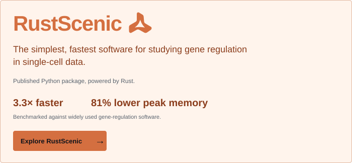
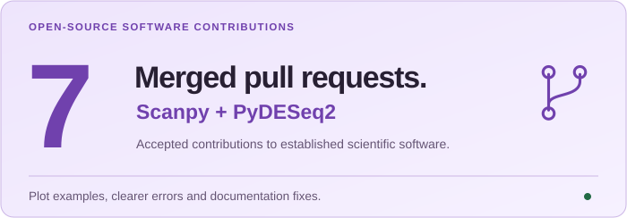
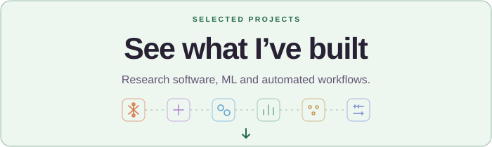

  <picture>
    <source media="(prefers-reduced-motion: reduce)" srcset="https://raw.githubusercontent.com/Ekin-Kahraman/Ekin-Kahraman/d9141734cef3da9c51df4ad51ea05a4006d3a8a1/assets/profile/workstation-still.svg">
    
  </picture>

 

  <picture>
    <source media="(prefers-reduced-motion: reduce) and (prefers-color-scheme: dark)" srcset="assets/profile/hello-still-dark.svg">
    <source media="(prefers-reduced-motion: reduce)" srcset="assets/profile/hello-still-light.svg">
    <source media="(prefers-color-scheme: dark)" srcset="assets/profile/hello-dark.svg">
    
  </picture>

<h3 align="center">Creator of RustScenic.</h3>

<picture></picture>

 

<a href="https://github.com/Ekin-Kahraman/rustscenic">
  <picture>
    <source media="(max-width: 520px) and (prefers-color-scheme: dark)" srcset="assets/profile/rustscenic-dark-mobile.svg">
    <source media="(max-width: 520px)" srcset="assets/profile/rustscenic-light-mobile.svg">
    <source media="(prefers-color-scheme: dark)" srcset="assets/profile/rustscenic-dark.svg">
    
  </picture>
</a>

 

  <strong>Leading RustScenic’s development</strong> at <a href="https://icahn.mssm.edu/">Mount Sinai</a>’s <a href="https://labs.icahn.mssm.edu/kuanhuanglab/">Huang Lab</a>, directly supervised by <a href="https://profiles.icahn.mssm.edu/kuan-lin-huang">Kuan&#8209;Lin&nbsp;Huang</a>&nbsp;.

 

---

 

<h3 align="center">&nbsp;Connect With Me</h3>

&emsp;

 

---

 

<h3 align="center"> Statistics</h3>

<a href="https://github.com/Ekin-Kahraman?tab=overview&amp;from=2026-01-01&amp;to=2026-12-31">
  <picture>
    <source media="(prefers-reduced-motion: reduce) and (prefers-color-scheme: dark)" srcset="https://raw.githubusercontent.com/Ekin-Kahraman/Ekin-Kahraman/47a55c0183aea09d463af1439d811d68985c9d3e/assets/profile/statistics-still-dark.svg">
    <source media="(prefers-reduced-motion: reduce)" srcset="https://raw.githubusercontent.com/Ekin-Kahraman/Ekin-Kahraman/47a55c0183aea09d463af1439d811d68985c9d3e/assets/profile/statistics-still-light.svg">
    <source media="(prefers-color-scheme: dark)" srcset="https://raw.githubusercontent.com/Ekin-Kahraman/Ekin-Kahraman/47a55c0183aea09d463af1439d811d68985c9d3e/assets/profile/statistics-dark.svg">
    
  </picture>
</a>

 

---

 

  <picture>
    <source media="(max-width: 520px) and (prefers-color-scheme: dark)" srcset="assets/profile/contributions-dark-mobile.svg">
    <source media="(max-width: 520px)" srcset="assets/profile/contributions-light-mobile.svg">
    <source media="(prefers-color-scheme: dark)" srcset="assets/profile/contributions-dark.svg">
    
  </picture>

  <a href="https://github.com/scverse/scanpy/pulls?q=is%3Apr+is%3Amerged+author%3AEkin-Kahraman"><picture>
    <source media="(max-width: 520px) and (prefers-color-scheme: dark)" srcset="assets/profile/contribution-link-scanpy-dark-mobile.svg">
    <source media="(max-width: 520px)" srcset="assets/profile/contribution-link-scanpy-light-mobile.svg">
    <source media="(prefers-color-scheme: dark)" srcset="assets/profile/contribution-link-scanpy-dark.svg">
    
  </picture></a>
  <a href="https://github.com/scverse/PyDESeq2/pulls?q=is%3Apr+is%3Amerged+author%3AEkin-Kahraman"><picture>
    <source media="(max-width: 520px) and (prefers-color-scheme: dark)" srcset="assets/profile/contribution-link-pydeseq2-dark-mobile.svg">
    <source media="(max-width: 520px)" srcset="assets/profile/contribution-link-pydeseq2-light-mobile.svg">
    <source media="(prefers-color-scheme: dark)" srcset="assets/profile/contribution-link-pydeseq2-dark.svg">
    
  </picture></a>

 

  <picture>
    <source media="(max-width: 520px) and (prefers-color-scheme: dark)" srcset="assets/profile/projects-invitation-dark-mobile.svg">
    <source media="(max-width: 520px)" srcset="assets/profile/projects-invitation-light-mobile.svg">
    <source media="(prefers-color-scheme: dark)" srcset="assets/profile/projects-invitation-dark.svg">
    
  </picture>

 
