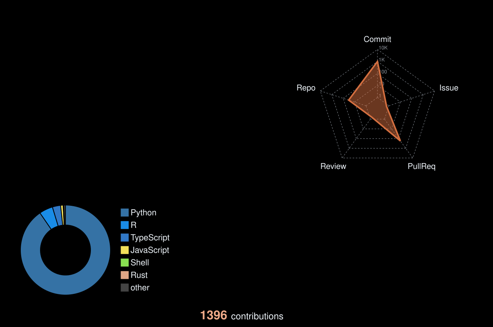

  <picture>
    <source media="(prefers-reduced-motion: reduce)" srcset="assets/profile/workstation-still.svg">
    
  </picture>

 

  <picture>
    <source media="(prefers-reduced-motion: reduce) and (prefers-color-scheme: dark)" srcset="assets/profile/hello-still-dark.svg">
    <source media="(prefers-reduced-motion: reduce)" srcset="assets/profile/hello-still-light.svg">
    <source media="(prefers-color-scheme: dark)" srcset="assets/profile/hello-dark.svg">
    
  </picture>
   
  <strong>Creator of RustScenic.</strong>

  

<a href="https://github.com/Ekin-Kahraman/rustscenic">
  <picture>
    <source media="(max-width: 520px) and (prefers-color-scheme: dark)" srcset="assets/profile/rustscenic-dark-mobile.svg">
    <source media="(max-width: 520px)" srcset="assets/profile/rustscenic-light-mobile.svg">
    <source media="(prefers-color-scheme: dark)" srcset="assets/profile/rustscenic-dark.svg">
    
  </picture>
</a>

 

  <strong>Leading RustScenic’s development</strong> at <a href="https://icahn.mssm.edu/">Mount Sinai</a>’s <a href="https://labs.icahn.mssm.edu/kuanhuanglab/">Huang Lab</a>, directly supervised by <a href="https://profiles.icahn.mssm.edu/kuan-lin-huang">Kuan&#8209;Lin&nbsp;Huang</a>&nbsp;.

 

---

 

<h3 align="center"> Connect With Me</h3>

 

 

---

 

<h3 align="center"> Statistics</h3>

<a href="https://github.com/Ekin-Kahraman?tab=overview&amp;from=2026-01-01&amp;to=2026-12-31">
  <picture>
    <source media="(prefers-reduced-motion: reduce) and (prefers-color-scheme: dark)" srcset="assets/profile/statistics-still-dark.svg">
    <source media="(prefers-reduced-motion: reduce)" srcset="assets/profile/statistics-still-light.svg">
    <source media="(prefers-color-scheme: dark)" srcset="assets/profile/statistics-dark.svg">
    
  </picture>
</a>

1,212 contributions · 2026

 

---

 

<h3 align="center">Open-source software contributions</h3>

<a href="https://github.com/scverse/scanpy/pulls?q=is%3Apr+is%3Amerged+author%3AEkin-Kahraman">Scanpy</a> · <a href="https://github.com/scverse/PyDESeq2/pulls?q=is%3Apr+is%3Amerged+author%3AEkin-Kahraman">PyDESeq2</a>

 

  <picture>
    <source media="(max-width: 520px) and (prefers-color-scheme: dark)" srcset="assets/profile/projects-dark-mobile.svg">
    <source media="(max-width: 520px)" srcset="assets/profile/projects-light-mobile.svg">
    <source media="(prefers-color-scheme: dark)" srcset="assets/profile/projects-dark.svg">
    
  </picture>

 
